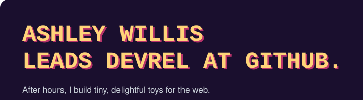
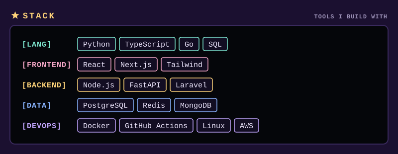
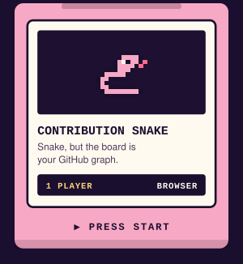
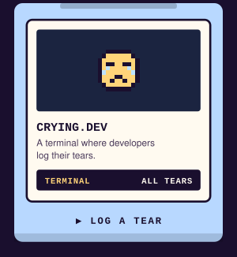
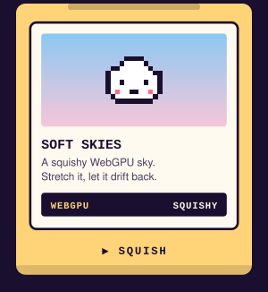
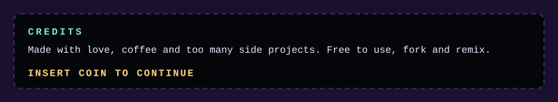

<a href="https://yetanothersnake.dev"><picture><source media="(max-width: 600px) and (prefers-color-scheme:light)" srcset="assets/phone/header-light.svg"><source media="(max-width: 600px)" srcset="assets/phone/header.svg"><source media="(prefers-color-scheme: light)" srcset="assets/header-light.svg"></picture></a><a href="https://github.com/USERNAME"><picture><source media="(max-width: 600px) and (prefers-color-scheme:light)" srcset="assets/phone/egg-light.svg"><source media="(max-width: 600px)" srcset="assets/phone/egg.svg"><source media="(prefers-color-scheme: light)" srcset="assets/egg-light.svg"></picture></a> 
<a href="https://github.com/USERNAME"><picture><source media="(max-width: 600px) and (prefers-color-scheme:light)" srcset="assets/phone/graph-light.svg"><source media="(max-width: 600px)" srcset="assets/phone/graph.svg"><source media="(prefers-color-scheme: light)" srcset="assets/graph-light.svg"></picture></a> 
<picture><source media="(max-width: 600px) and (prefers-color-scheme:light)" srcset="assets/phone/stack-light.svg"><source media="(max-width: 600px)" srcset="assets/phone/stack.svg"><source media="(prefers-color-scheme: light)" srcset="assets/stack-light.svg"></picture> 
<a href="https://github.com/USERNAME"><picture><source media="(max-width: 600px) and (prefers-color-scheme:light)" srcset="assets/phone/cart-1-light.svg"><source media="(max-width: 600px)" srcset="assets/phone/cart-1.svg"><source media="(prefers-color-scheme: light)" srcset="assets/cart-1-light.svg"></picture></a><a href="https://github.com/USERNAME"><picture><source media="(max-width: 600px) and (prefers-color-scheme:light)" srcset="assets/phone/cart-2-light.svg"><source media="(max-width: 600px)" srcset="assets/phone/cart-2.svg"><source media="(prefers-color-scheme: light)" srcset="assets/cart-2-light.svg"></picture></a><a href="https://github.com/USERNAME"><picture><source media="(max-width: 600px) and (prefers-color-scheme:light)" srcset="assets/phone/cart-3-light.svg"><source media="(max-width: 600px)" srcset="assets/phone/cart-3.svg"><source media="(prefers-color-scheme: light)" srcset="assets/cart-3-light.svg"></picture></a> 
<a href="https://github.com/USERNAME"><picture><source media="(max-width: 600px) and (prefers-color-scheme:light)" srcset="assets/phone/credits-light.svg"><source media="(max-width: 600px)" srcset="assets/phone/credits.svg"><source media="(prefers-color-scheme: light)" srcset="assets/credits-light.svg"></picture></a>

